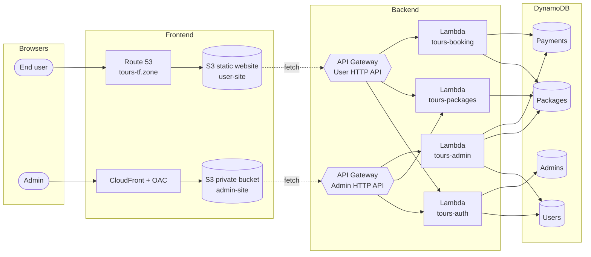

# ✈️ Tours & Travels – Serverless Website on AWS (Terraform + GitHub Actions)

A fully serverless tours and travel booking website. Customers register, log in, choose a tour
package, pick a travel mode (flight, bus or transport), pay by UPI QR code and manage or cancel
bookings. An admin dashboard shows every registration, booking, payment and package in one place.

The whole stack is created by **Terraform** and deployed by a **GitHub Actions** workflow on every push to `main`.
No servers to manage.

## Website


> This image is hosted on a Kommodo share link that **expires on Dec 14, 2026**. To keep it permanently,
> download it, save it as `docs/screenshot.png`, and change the image path above to `docs/screenshot.png`.

---

## Architecture



### Request flow
| Who | Path |
|---|---|
| **End user** | Browser → **Route 53** → **S3** static website → JavaScript calls the **User API Gateway** → **Lambda** → **DynamoDB** |
| **Admin** | Browser → **CloudFront** → private **S3** bucket → JavaScript calls the **Admin API Gateway** → **Lambda** → **DynamoDB** |

S3 cannot call Lambda directly, so the JavaScript in each page calls its own API Gateway.
The admin API only accepts browser calls from the admin CloudFront site (CORS), and the admin S3 bucket is not public.

---

## AWS services used

**8 AWS services** (7 created directly by Terraform, plus CloudWatch Logs which Lambda uses automatically),
and **3 tools** outside AWS.

| # | Service | What it does in this project | Terraform resources |
|---|---|---|---|
| 1 | **Amazon S3** | User website bucket (public website hosting), admin website bucket (private), Terraform state bucket | 2 buckets + website config, public access blocks, 2 bucket policies (state bucket is created once by hand) |
| 2 | **Amazon Route 53** | DNS alias record `tours-tf.<zone>` pointing to the user website | 1 record (existing hosted zone is looked up) |
| 3 | **Amazon CloudFront** | HTTPS front door for the admin site, with Origin Access Control so S3 stays private | 1 distribution + 1 origin access control |
| 4 | **Amazon API Gateway** | Two HTTP APIs (user and admin), 13 routes in total | 2 APIs, 2 stages, 6 integrations, 13 routes |
| 5 | **AWS Lambda** | 4 Node.js 20 functions with all business logic | 4 functions + 6 invoke permissions |
| 6 | **Amazon DynamoDB** | 4 on-demand tables | 4 tables + seed items (1 admin, 7 sample packages) |
| 7 | **AWS IAM** | One execution role for the Lambdas (logs + DynamoDB access) | 1 role, 1 managed policy attachment, 1 inline policy |
| 8 | **Amazon CloudWatch Logs** | Lambda logs, enabled through `AWSLambdaBasicExecutionRole` | (automatic) |

| Tool | Role |
|---|---|
| **Terraform** (providers: `aws`, `archive`, `random`) | Infrastructure as code. Zips the Lambda code and generates the token-signing secret |
| **GitHub** | Source repository |
| **GitHub Actions** | CI/CD: validate, plan, apply, upload both websites |

Browser-side libraries: Google Fonts, `qrcodejs` from cdnjs (QR code), and one Unsplash hero image.

`terraform plan` reports about **58 resources** to create.

---

## DynamoDB tables (4)

| Table | Partition key | Stores | Written by |
|---|---|---|---|
| **Users** | `email` | registered customers (name, phone, password hash) | `tours-auth` |
| **Admins** | `username` | admin login (password hash) | Terraform |
| **Packages** | `packageId` | tour packages (name, destination, days, price, image) | admin via `tours-packages`, seeded by Terraform |
| **Payments** | `paymentId` | bookings and payments in one record (status, amount, refund) | `tours-booking`, `tours-admin` |

## Lambda functions (4) and API routes (13)

| Lambda | API | Routes | Tables |
|---|---|---|---|
| `tours-auth` | user + admin | `POST /register`, `POST /login`, `POST /admin/login` | Users, Admins |
| `tours-packages` | user + admin | `GET /packages`, `POST /admin/package`, `DELETE /admin/package` | Packages |
| `tours-booking` | user | `POST /book`, `POST /pay`, `GET /mybookings`, `POST /cancel` | Packages, Payments |
| `tours-admin` | admin | `GET /admin/summary`, `POST /admin/payment`, `DELETE /admin/payment` | Users, Packages, Payments |

Login returns a signed token (HMAC-SHA256, 24 hours). User and admin tokens have different roles, so a user token cannot call admin routes.

## How the data stays in sync
- The admin Lambda reads the Users, Packages and Payments tables in one call and **joins** them. The dashboard
  shows registrations, bookings, payments, per-destination revenue and a recent-activity feed together.
- The admin dashboard refreshes itself every 15 seconds.
- Both websites read packages live from the Packages table, so adding or deleting a package shows up on both sites straight away.

## Features

**Customer site**
- Landing page with live packages, search, and a login or register pop-up
- Dashboard with search and sort, a booking pop-up (travel mode, date, members, price breakdown)
- UPI **QR code** payment, then a confirmation with the booking ID
- My Bookings with cancel and automatic refund

**Cancellation policy (calculated by the Lambda)**

| Cancel at | Refund |
|---|---|
| 10 or more days before departure | 80% |
| 5 to 9 days before departure | 10% |
| Less than 5 days before departure | 0% |

**Admin site**
- Login button in the top bar, then the dashboard
- **Top bar** (right side): live status, 🔔 **Recent activity** drop-down, admin label and Logout
- Stat cards (net revenue, bookings, users, packages), revenue-by-destination chart
- Packages (add with image URL, delete, multi-select), bookings, payments (add or delete), users with booking count and total spent

---

## Project structure

```
.
├── .github/workflows/deploy.yml   # CI/CD: init, validate, plan, apply, upload sites
├── terraform/
│   ├── backend.tf                 # S3 remote state
│   ├── main.tf                    # all AWS resources
│   ├── variables.tf               # region, zone, subdomain, UPI ID, admin hash, seed packages
│   └── outputs.tf                 # API URLs, bucket names, site URLs
├── lambdas/
│   ├── tours-auth/index.mjs
│   ├── tours-packages/index.mjs
│   ├── tours-booking/index.mjs
│   └── tours-admin/index.mjs
├── user-site/                     # index.html, dashboard.html, style.css
├── admin-site/                    # index.html, dashboard.html, style.css
└── README.md
```

`config.js` (the API URL) is generated by the workflow for each site. Do not commit it.

---

## Deploy

### One-time setup
1. **State bucket** (AWS CloudShell, us-east-1). The name must match `terraform/backend.tf`:
   ```bash
   aws s3api create-bucket --bucket tours-tfstate-215726090298 --region us-east-1
   aws s3api put-bucket-versioning --bucket tours-tfstate-215726090298 --versioning-configuration Status=Enabled
   ```
2. **Access keys:** IAM → Users → create `github-deploy` with `AdministratorAccess` (lab) → Security credentials → Create access key (CLI).
   Use permanent keys. The workflow does not send a session token.
3. **GitHub secrets** (Settings → Secrets and variables → Actions):
   - Secrets: `AWS_ACCESS_KEY_ID`, `AWS_SECRET_ACCESS_KEY`, `UPI_ID`
   - Optional variable: `TF_STATE_BUCKET` (if empty, the bucket in `backend.tf` is used)
4. **Edit `terraform/variables.tf`** if your Route 53 zone differs: `zone_name` (a **public** hosted zone in the same account) and `subdomain`.
5. **Push to `main`:**
   ```bash
   git add . && git commit -m "deploy" && git push
   ```

### What the workflow does
1. Logs in to AWS with the access keys
2. `terraform init` → `validate` → `plan` → `apply`
3. Writes `config.js` with each API URL and syncs `user-site/` and `admin-site/` to their S3 buckets
4. Prints the URLs (**Show URLs** step)

### After it finishes
| Site | URL |
|---|---|
| User | `http://tours-tf.<your-zone>` (S3 website endpoints are HTTP) |
| Admin | the `https://dxxxx.cloudfront.net` URL from the **Show URLs** step |

Default admin login: **`admin` / `admin123`**. Change `admin_password_hash` (SHA-256 of the new password) in `variables.tf` before any real use.

### Remove everything
```bash
cd terraform && terraform init && terraform destroy
```

---

## Security notes
- Never commit access keys. Keep them only in GitHub secrets.
- Passwords are stored as SHA-256 hashes. For a production site, switch to a salted algorithm such as bcrypt or Argon2, or use Amazon Cognito.
- The Lambda signing secret is generated by Terraform (`random_password`) and stored in the Lambda environment.
- The admin S3 bucket is private and reachable only through CloudFront. The admin API only allows the CloudFront origin.
- The payment step confirms after the user clicks "I have paid". Real payment verification needs a payment gateway.
- `AdministratorAccess` for the deploy user is for a lab only. Use a least-privilege policy for real projects.